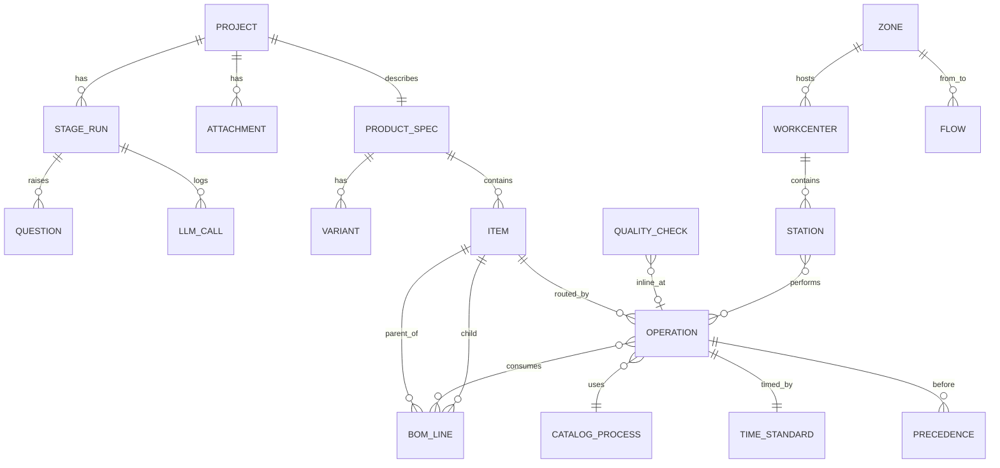

# 04 — Data model and SysML v2

## 1. Principles

- **Pydantic v2 domain model is the model of record** (ADR-002). JSON Schema and TypeScript types are generated from it; the database stores validated JSON per artifact plus a few relational tables for querying.
- **Artifacts are immutable and versioned** per stage run. References between artifacts use `(artifact_kind, version, local_id)`.
- **Provenance on values** (`Prov[T]`: value, unit, source, confidence, ref, note).
- **IDs are stable strings** inside a project (`PB-0012`, `OP-030`, `WC-WELD-01`, `Z-STORE-LI`) so diffs between versions are readable.

## 2. Entity overview



Catalog and data-pack entities (`CATALOG_PROCESS`, `MACHINE_CLASS`, `CHECK_TYPE`, `PACK_VALUE`) live in a separate schema, versioned, and referenced by code + version.

## 3. Core types (abbreviated)

```python
class Prov(BaseModel, Generic[T]):
    value: T; unit: str | None = None
    source: Literal["user","cad","datasheet","vision","llm","library","web","engine","bom_file"]
    confidence: confloat(ge=0, le=1); ref: str | None = None; note: str | None = None

class Project(BaseModel):
    id: UUID; share_token: str; created_at: datetime; expires_at: datetime
    catalog_version: str; pack_versions: dict[str, str]     # {"KA": "2026.11.1"}
    template_version: int

class StageRun(BaseModel):
    id: UUID; project_id: UUID; stage: StageKey; version: int
    status: Literal["pending","running","awaiting_approval","approved","rejected","stale","failed"]
    inputs_hash: str; upstream: dict[StageKey, int]; params: dict
    artifact: dict            # validated against the stage's artifact model
    summary: str; assumptions: list[Assumption]; created_at: datetime

class Item(BaseModel):
    part_no: str; name: str; kind: Literal["product","assembly","part","consumable","packaging"]
    material: Prov[str] | None; mass_g: Prov[float] | None; bbox_mm: Prov[tuple[float,float,float]] | None
    commodity_class: str | None; make_or_buy: Prov[Literal["make","buy"]]
    variants: list[str]       # variant codes this item belongs to ([] = all)

class BomLine(BaseModel):
    parent: str; child: str; qty: Prov[float]; uom: str; variant: str | None
    level: Literal["ebom","mbom"]; ebom_ref: str | None

class Operation(BaseModel):
    op_no: str; item: str; process: CatalogRef; description: str
    workcenter_class: str; consumes: list[str]; produces: str
    time: TimeStandard; quality_gate: str | None; batch: BatchSpec | None
    variant_times: dict[str, TimeStandard] = {}     # per-variant overrides

class TimeStandard(BaseModel):
    cycle_s: Prov[float]; setup_s: Prov[float] = 0; handling_s: float = 0
    method: Literal["user","catalog_formula","mtm_table","llm_estimate","measured"]
    distribution: Literal["fixed","triangular","lognormal"] = "triangular"
    spread_pct: float = 15     # for simulation

class Precedence(BaseModel): from_op: str; to_op: str

class Station(BaseModel):
    id: str; workcenter: str; ops: list[str]; operators: int; machines: dict[str, int]
    load_s_by_variant: dict[str, float]; utilisation: float

class Zone(BaseModel):
    id: str; kind: ZoneKind; area_m2: float; min_aspect: float; max_aspect: float
    constraints: list[ZoneConstraint]      # e.g. hazard_li_ion, near_dock, esd, keep_apart(Z-CANTEEN)
    utilities: UtilityNeeds; height_m: float

class Flow(BaseModel): from_zone: str; to_zone: str; loads_per_day: float; unit_load: str
```

All stage artifacts (`ProductSpec`, `Bom`, `Routing`, `QualityPlan`, `CapacityDesign`, `InventoryDesign`, `WorkOrderDesign`, `Roster`, `UtilityDesign`, `Layout`, `SimResult`, `FinanceModel`, `VendorReport`, `ReportPack`) are defined in `packages/domain` with docstrings and examples.

## 4. Storage

| Table | Content |
|---|---|
| `project` | id, share_token (hashed), expiry, versions pinned |
| `stage_run` | per stage version; `artifact jsonb` validated on write |
| `attachment` | file metadata; files on disk under `/data/projects/<id>/` |
| `question`, `answer` | typed questions per stage run |
| `llm_call` | role, model, tokens in/out, latency, status |
| `job` | worker jobs (if Postgres-backed queue) |
| `catalog_*`, `pack_value` | versioned library data (doc 10) |
| `vendor_cache` | shared vendor facts with source URL and TTL |
| LangGraph checkpoint tables | graph state only (IDs) |

pgvector index on catalog entries (name + description + aliases) for `catalog.search`.

## 5. Validators (run in every write)

| Artifact | Checks |
|---|---|
| ProductSpec | Required tier present; variant mix = 100%; units valid |
| Bom | Complete MBOM per variant; no cycles in BoM tree; commodity classes exist |
| Routing | Precedence graph acyclic; every MBOM line consumed exactly by ≥1 operation; every op has a workcenter class; every time has a method |
| QualityPlan | Every IQC item exists in MBOM; every inline check maps to an op; AQL plans valid for lot sizes |
| CapacityDesign | Every op assigned once per strategy; station load ≤ PCT × (1 + allowed overload) per variant; precedence respected |
| InventoryDesign | Every MBOM item has a policy; zones have area > 0; hazard items in hazard zones |
| Roster | Hours within pack limits; every station staffed every shift |
| UtilityDesign | Transformer ≥ MD × headroom; all equipment loads counted |
| Layout | No overlaps; inside boundary; aisles ≥ minimum; keep-apart distances; exit travel distance |
| FinanceModel | Totals reconcile with source artifacts |

## 6. SysML v2 mapping

The SysML v2 model is generated from approved artifacts at S12 (and on demand). The serializer is our own thin module writing textual notation for a defined subset; output is parsed and checked with `sysmlpy` (and optionally OpenSysML's CLI) in CI. `sysml2kit` is evaluated in P0 as an alternative writer (it is pre-alpha).

| Domain | SysML v2 construct |
|---|---|
| Product, variants | `part def Product`; variants as specialisations (`part def PB10K :> PowerBank`) or `variation`/`variant` |
| Items / BoM | `part def` per item; BoM lines as `part` usages with multiplicity |
| Materials, mass, dims | `attribute` with ISQ units |
| Operations / routing | `action def` per operation; routing as an `action` with `succession` (`first … then …`) from the precedence graph |
| Workcenters, stations, machines | `part def Workcenter`, `part def Station`; ops allocated with `allocate` |
| Zones, factory | `part def Factory` containing zones and workcenters |
| Material flow | `flow` / `connection` between zone ports with item types |
| Requirements (volume, takt, compliance) | `requirement def` with `satisfy` links from the design |
| Quality checks | `verification def` / `verify` linked to requirements |
| Utility limits | `constraint def` (e.g. MD ≤ contract demand) |
| Engine results | `analysis def` with result attributes (takt, utilisation, NPV) |

Example fragment:

```sysml
package PowerBankFactory {
  import ISQ::*; import SI::*;
  part def PowerBank { attribute ratedCapacity : ElectricChargeValue; }
  part def PB10K :> PowerBank;
  action def SpotWeldPack;  action def FunctionalTest;
  action routingPB10K { action weld : SpotWeldPack; then action test : FunctionalTest; }
  part def Station; part factory { part st04 : Station; part st07 : Station; }
  allocate routingPB10K.weld to factory.st04;
  requirement def ThroughputReq { attribute unitsPerDay : Real = 1000; }
}
```
